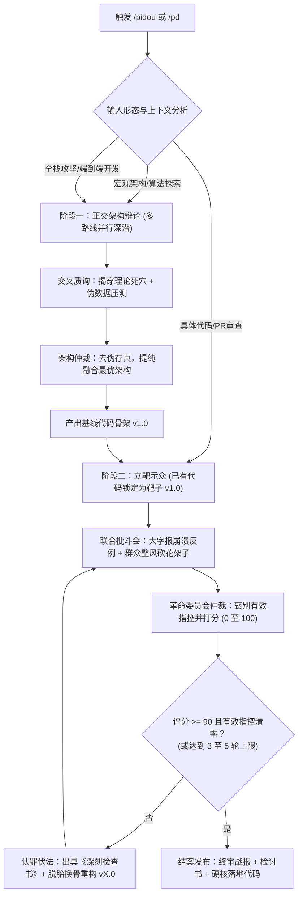

# Antigravity Agent Rules & Discipline Protocols
### 智能体行为基线规则、工程纪律规范与全周期自适应批斗整风协议 (/pidou & /pd)

[](LICENSE)
[](https://antigravity.google)
[](#二-智能体工程纪律守则-disciplinemd)

面向 **Google Antigravity** 及现代自主 AI 智能体（Agent）的工业级治理框架、工程防护底线与高强度自适应对抗整风协议。

---

## 💡 为什么需要这套规范？

在日常使用 AI 编程智能体时，开发者经常面临四大顽疾：
1. **“罗嗦絮叨、答非所问”**：智能体充斥大量客套寒暄、机械复述用户问题，堆砌泛泛科普，有效信息密度极低；
2. **“盲从附和、不敢进谏”**：对用户提出的存在重大缺陷或高危隐患的方案唯唯诺诺、盲目附和，缺乏专业纠偏担当；
3. **“盲目死循环硬试”**：遇到报错时，在同一个错误路线上连续盲试十几次，浪费 Token 并污染代码库与 Git 提交；
4. **“形式主义与投机偷懒”**：写出空捕获 `catch(e) {}`、虚假 mock 测试绕过断言，或堆砌层层无用工厂与过度工程。

本项目通过**硬性基线规约**、**极简回答交付**、**敢于直言进谏**、**两击即停纪律**与**全周期自适应批斗整风（/pidou & /pd）**，逼出高信噪比交付、最稳健架构与极致硬核代码。

---

## 📂 项目模块结构

```text
antigravity-agent-rules/
├── rules/
│   ├── GEMINI.md                    # 全局硬性基线规则（极简回答、直言进谏、批斗准则、开源交付红线、Git控制）
│   ├── discipline.md                # 智能体纪律守则（连贯自主推进、受阻主动换道、2分钟心跳、两击即停红线）
│   ├── academic-authorship.md       # 学术研究与论文撰写贡献规约
│   ├── cloudflare-wechat-delivery.md# Cloudflare 边缘分发与微信生态访问保障规约
│   ├── github-publishing.md         # GitHub 仓库发布与分类标签（Topics）规范
│   ├── oss-contribution.md          # 开源贡献与 PR 交付硬性红线（防死代码、跨平台对齐、防 AI 垃圾）
│   └── web-performance-rendering.md # 极速 Web 渲染性能、移动端触控交互与全端排版防崩规约
├── skills/
│   ├── android-fast-automation/     # Android 极速自动化与移动网络诊断技能 (Python Socket 直连 5037)
│   │   └── SKILL.md
│   ├── artemis-mobile-agent/        # Google Artemis 多模态 Android 端到端自动化操作 Agent
│   │   └── SKILL.md
│   ├── pd/                          # 批斗模式技能主目录 (/pd 别名)
│   │   ├── SKILL.md                 # 全周期自适应批斗模式技能定义
│   │   └── references/
│   │       └── prompts.md           # 辩论与整风全角色 Prompt 模板库
│   ├── pidou/                       # 批斗模式双向兼容镜像目录 (/pidou 别名)
│   │   ├── SKILL.md
│   │   └── references/
│   │       └── prompts.md
│   ├── rea-reverse-engineering/     # REA 逆向工程与软件分析 Agent 工具链 (APK/JS/二进制分析)
│   │   └── SKILL.md
│   └── xiazai/                      # 网盘与网络资源极速下载闭环模式 (/xiazai)
│       └── SKILL.md
└── scripts/
    ├── install.bat                  # Windows 批处理一键安装（双击直达）
    ├── install.ps1                  # Windows PowerShell 一键部署脚本
    └── install.sh                   # Linux/macOS Bash 一键部署脚本
```

---

## 🛡️ 核心模块详解

### 一、 全局硬性基线规则 (`rules/GEMINI.md`)
注入为系统全局核心约束，杜绝智能体产生噪音与环境破坏：
- **极简回答与重点交付**：废除一切开场寒暄与客套，严禁机械复述问题，严禁无关科普；只说重点，直接给出核心动作、代码变更、实测数据与关键结论；
- **敢于直言进谏与纠偏**：拒绝盲从（Zero Sycophancy）。发现架构硬伤、崩溃死锁隐患或显著更优解时，必须一针见血点明病灶，直接给出降维打击更优解；
- **全周期自适应批斗整风**：监听 `/pidou`、`/pd`、`批斗模式`、`互相批斗` 等别名，全生命周期自适应路由，并支持智能体中途自主激活；
- **Git 强制提交与备份纯粹性**：修改代码与文件必须规范提交（Conventional Commits），严禁遗留脏工作区，通过 Git 记录历史，**严禁额外生成物理备份文件**（`*.bak` 等）；
- **环境与防灾铁律**：
  - Windows 批处理脚本（.bat）CRLF 换行、严禁多字节中文路径导致 CMD 乱码、末尾强制 `pause` 防闪退；
  - 本地服务与浏览器防抢锁（禁止沙箱自动唤起 GUI 浏览器、Profile 独立隔离、僵死进程诊断）；
  - 静态资源动态时间戳防缓存穿透与多入口一致性校验；
  - Android 移动端自动化禁止单步 uiautomator dump、ADB 二进制流防 UTF-16 污染、Socket 直连 5037 极速触控。

---

## 二、 智能体工程纪律守则 (`rules/discipline.md`)
针对多步复杂任务与报错排查的最高行动准则：

### 1. 连贯推进与流式透明播报（东西继续做）
- **自主连续闭环**：严禁每做一两步就擅自中断讨要指令，任务以自主闭环为导向连续推进；
- **严禁裸调工具（同轮有声）**：调用工具时必须同轮输出 1 句简明口语，杜绝界面静止的无声黑盒。

### 2. 卡点受阻主动转向（换道告知，立即实施）
- 遇阻或报错时严禁死磕盲试，也严禁直接摆烂停滞；
- 必须立即重新推导替代方案，用 1 至 2 句话向用户汇报转向逻辑，并**紧接着连续执行新方案**。

### 3. 2 分钟强制进度与卡点心跳 (2-Minute Heartbeat)
- 单任务排障、构建或复杂攻坚耗时凡达 **2 分钟**，强制发声同步当前进展、核心卡点瓶颈与新动作，消除信息真空。

### 4. “两击即停”红线（严惩死循环盲试）
- **尝试上限**：针对同一技术卡点、报错或测试失败，最多只允许自主调整并尝试 **2 次**；
- **两击即停**：第 2 次尝试若仍未解决，**严禁自行发起第 3 次盲目重试**，必须立即暂停工具调用，主动向用户说明情况、复盘已尝试方案、指出卡点原因并给出 1 至 3 个应对选项；
- **严禁掩盖问题**：严禁私自注释断言、强行绕过异常或编写虚假 mock 欺骗流程。

---

## 三、 全周期自适应批斗模式 (`skills/pd/` & `skills/pidou/`)
结合方案阶段**正交多路线架构辩论**与落地阶段**红蓝极端整风代码批斗**的融合型工作流。

### 1. 自适应调度矩阵 (Adaptive Dispatch)
| 触发形态 | 自适应模式 | 核心执行动作 |
| :--- | :--- | :--- |
| **仅提供概念/需求/算法假说/未定架构** | **【阶段一：正交架构辩论】** | 冻结编码，派生激进、务实、第三视角对立专家，深挖理论死穴与压测，收敛唯一架构。 |
| **输入包含具体源码/PR/函数实现/Bug崩溃** | **【阶段二：代码整风流】** | 锁定靶子，红队大字报贴致命崩溃反例，群众整风砍花架子，认罪重构直至 90 分。 |
| **端到端复杂攻坚/全栈研发** | **【双阶段全链路闭环】** | 阶段一辩出最优架构 -> 阶段二落地极限红蓝整风 -> 交付终审硬核代码。 |
| **编码过程中突遇高危死锁/方案分歧** | **【中途自主激活】** | 智能体自主切入局部红蓝互批推演，解决卡点后回归主线。 |

### 2. 执行流程图



### 3. 全角色设定与审查矩阵
- **`arch_pioneer`（激进创新架构师）**：物理第一性原理、纯算法重构、极致吞吐与无锁化；
- **`arch_pragmatist`（稳健务实架构师）**：工程落地、多尺度解耦、低认知负荷与高可读性；
- **`arch_challenger`（第三视角破坏者）**：拓扑突变、流形变换、非对称逆向攻击、审查伪数据口径；
- **`pd_inquisitor`（大字报批斗官）**：红队刺客，必须附带**具体致命崩溃反例**（死锁、OOM、雪崩、未防护空值）；
- **`pd_pragmatist`（群众整风官）**：工农兵代表，反对形式主义与过度工程，勒令砍掉一切抽象花架子；
- **`pd_defendant`（认罪重构员）**：老实认罪，撰写《深刻检查书》，出具脱胎换骨的全新重构代码；
- **`pd_arbiter`（革命委员会仲裁官）**：铁面无私、事实裁判，严格评分（0 至 100 分），有效指控清零且得分 ≥ 90 方可放行。

---

## 四、 GitHub 仓库发布规约 (`rules/github-publishing.md`)
在 GitHub 上创建、初始化或正式发布项目仓库时的强制约束：
1. **强制配置分类检索标签（Topics）**：必须配置 3 至 6 个精准高相关的标签，严禁空描述发布；
2. **格式规范**：仅支持小写字母、数字和中划线（`-`），单标签长度严格控制在 50 字符以内；
3. **时机要求**：首个 commit 推送后立即补充配置。

---

## 五、 开源贡献与 PR 交付红线 (`rules/oss-contribution.md`)
为开源项目提交流程与代码补丁时的六大红线：
1. **绝不提交不可达架子代码**：新增代码必须有真实业务消费者，禁止仅在测试中被调用的纯模型；
2. **严防 Windows 宿主偏见**：杜绝反斜杠与驱动器号假象，显式在 POSIX / Linux / macOS 下边界对齐；
3. **凭据安全防御**：敏感字段 Debug 输出强制脱敏为 `<redacted>`，序列化强制跳过；
4. **拒绝脆弱正则修补**：复杂语法结构基于 AST 或词法状态机解析，严禁暴力正则全局替换；
5. **反 AI 垃圾与八股**：严格遵守 upstream CONTRIBUTING 规范，PR 说明直击要害，杜绝套话。

---

## 六、 Android 极速自动化与网络诊断 (`skills/android-fast-automation/`)
面向 Android 移动端测试与网络调试的工业级技能库：
- **极速触控与截图**：基于 Python 原生 Socket 直连 `127.0.0.1:5037`，触控延迟 46 毫秒，内存二进制直读截图 330 毫秒（彻底杜绝 PowerShell 编码污染）；
- **移动网络诊断栈**：区分应用层直连与系统 TUN 虚拟网卡假死，支持 Deep Link 意图直通及 Android 15 eBPF 兼容性排障。

---

## 七、 全自动开源 Bug 修复与 PR 交付模式 (`skills/pr/`)
面向开源项目贡献与上游维护的工业级全自动端到端技能库：
- **触发指令**：输入 `/pr` 即可一键端到端全自动运行；
- **全流程六步闭环**：存量 PR 门禁自动抢修 -> 1000+ Star 项目无争议 Bug 甄选 -> `uv` 秒级轻量隔离复现 -> 根因修复与回归单测 -> 本地 Linter 零报错门禁 -> 规范保真 PR 交付与持续推进；
- **内置工业级防御**：非交互 Fork 防卡死、换行符（CRLF/LF）防漂移、`--body-file` 引号防崩溃、已合 Issue 幽灵探查及上游频控智能换道。

---

## 八、 网盘与网络资源极速下载模式 (`skills/xiazai/`)
面向网盘资源（夸克、百度网盘、阿里云盘、115、迅雷、123网盘等）与直链资源的高信噪比自动化下载作业流：
- **无感自动意图识别**：支持显式 `/xiazai` 或自动监听对话中的“帮我下载…”及网盘分享链接，零指令门槛；
- **智能双轨分流**：
  - **小文件直链直推**：调用轻量 API 提取真实 CDN 直链，通过 JSON-RPC 推送到后台常驻 Aria2 服务（16线程并发）满速落盘至 `D:\Downloads`；
  - **大文件客户端直通**：针对 1GB+ 或受服务端风控拦截的大文件，自动探测并唤起本地已安装官方客户端（如 `D:\Quark\quark.exe`），彻底阻断网页端反复重定向；
- **后台引擎自愈**：每次任务前自动校验 6800 端口，未拉起则静默启动常驻守护进程。

---

## 🚀 快速安装与使用

### 1. 克隆并安装到当前设备

#### Windows
```powershell
git clone https://github.com/cf3901646/antigravity-agent-rules.git
cd antigravity-agent-rules

# 方式一：直接双击运行 scripts\install.bat
# 方式二：PowerShell 执行
.\scripts\install.ps1
```

#### Linux / macOS (Bash)
```bash
git clone https://github.com/cf3901646/antigravity-agent-rules.git
cd antigravity-agent-rules
chmod +x ./scripts/install.sh
./scripts/install.sh
```

### 2. 使用示例
安装完成后，在任意 Antigravity / Gemini 智能体会话中：
- **日常交互**：智能体自动继承《极简回答》、《直言进谏》与《智能体纪律守则》（自动两击即停，禁止擅自启动浏览器等）；
- **呼唤批斗模式**：在对话中输入 `/pidou`、`/pd`、`批斗` 或 `帮我批斗一下这段代码`，即可自动激活多智能体残酷互批工作流！
- **自动开源贡献模式**：在对话中输入 `/pr`，即可全自动完成存量 PR 门禁自愈、1000+ Star 项目 Bug 探测、秒级单测验证与上游 Pull Request 规范交付！

---

## 🏷️ 推荐 GitHub Topics

发布此项目时，推荐在 GitHub 仓库的「About」设置中配置以下 6 个 Topics：
`antigravity` `ai-agents` `multi-agent` `prompt-engineering` `coding-assistant` `red-teaming`

---

## 📄 License

本项目采用 [MIT License](LICENSE) 开源许可协议。
