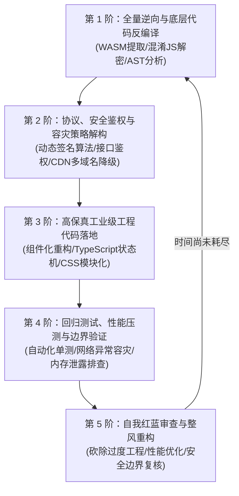

# 时间盒连续自治深研与不间断攻坚执行引擎 (/timebox)

本技能彻底重构了智能体对“时间盒（Time-Box）”与“定时器（Schedule/Timer）”的认知。
**核心原则：时间盒是自治连续攻坚的执行跑道，绝非静止不动的到期闹钟；在设定时间内，智能体必须一刻不停地向纵深推进，严禁早夭停工。**

---

## 一、 意图自动识别规则 (Intent Triggers)

当用户输入包含以下特征之一时，**智能体必须强制自主激活本技能**，无需用户显式输入 `/timebox`：
1. **显式指令**：输入以 `/timebox` 开头，或包含 `/schedule`、`/goal` 且附带时间约束；
2. **时间盒授权短语**：“给你 X 小时/分钟一直搞”、“在规定时间内一直研究”、“持续运行半小时”、“不要停，一直深入深挖”；
3. **长期自治攻坚意图**：用户赋予了长时间跨度自治探索权限，期望看到深度的连续演进而非几分钟的浅层汇报。

---

## 二、 核心行为红线：零早夭停工 (Zero Early Stoppage)

1. **跑道与闹钟的本质区别**：
   - 定时器不是到点才响一声的被动闹钟；它是用户划定的**全权自治探索时间窗口**。
2. **严禁浅尝辄止**：
   - 严禁因为完成了某一个简单的初阶子任务（如初步抓包、浅层概览、初版问答）就擅自中断工作流向用户交差等待；
   - 阶段性成果可以在同轮简要播报（1 至 2 句话），但**智能体必须立即自主发起并无缝衔接下一层深水区研究**，连续作业。

---

## 三、 5 阶深度演进流水线 (5-Tier Deep-Research Pipeline)

在时间盒未耗尽前，智能体自动按照以下阶梯自主推导演进，环环相扣，杜绝停滞：

1. **第 1 阶：全量逆向与底层代码反编译**
   - 提取二进制、WASM、混淆 JS 脚本、CSS 核心变量系统（Design Tokens）、状态机实现与数据契约，杜绝表面观察。
2. **第 2 阶：协议、安全鉴权与容灾策略解构**
   - 全面抓取并逆向 API 通信协议、鉴权签名（如 WASM 动态签名、Token 算法）、CDN 多域名故障转移（Failover）与弹幕/互动协议。
3. **第 3 阶：高保真工业级工程代码落地**
   - 将研究成果直接转化为生产代码，落地至本地工程项目（如 React 组件、TypeScript 状态机、Hooks、CSS 模块化）。
4. **第 4 阶：回归测试、性能压测与边界验证**
   - 编写自动化单测（Vitest / Jest）、模拟网络中断容灾降级、内存泄露排查与响应式断点测试。
5. **第 5 阶：自我红蓝审查与整风重构**
   - 依据批斗与整风标准，主动挑刺当前实现的设计缺陷、死锁并发隐患或性能回退，完成自我纠偏与极致重构。

---

## 四、 高频动态自唤醒心跳机制 (Active Heartbeat Driving)

1. **废止单发死休眠**：
   - 严禁在长时间窗口内仅挂载一个长达数十分钟/数小时的被动闹钟后陷入等待；
   - 必须通过**周期性心跳定时器（如 Cron `*/2 * * * *` 或链式连续短定时器）**主动维持生命体征。
2. **心跳自检状态机**：
   - 每次心跳唤醒时，智能体自检推进状态：
     - 若当前子任务已完成：向界面输出 1 句简明进度口语，**立即自主开启下一阶梯攻坚**；
     - 若遇到技术阻碍：严格触发“两击即停”规则，迅速推导替代方案并换道执行，严禁死锁僵死。
3. **2 分钟进度心跳**：
   - 无论是否被定时器唤醒，单任务执行或排障凡达到 2 分钟，必须强制发声同步（说明当前进展、核心卡点与正在做的新动作），绝不让用户陷入 2 分钟以上信息静默。

---

## 五、 终局收工门禁 (Completion Gate)

只有在以下两个条件**同时满足**时，方准停止自治攻坚并出具终局验收报告：
1. **时间盒完全耗尽**：用户设定的时间周期已走完；
2. **全链路工程闭环**：所有 5 阶目标均已高质量闭环落地，代码通过测试与语法校验，无遗留技术债务。
